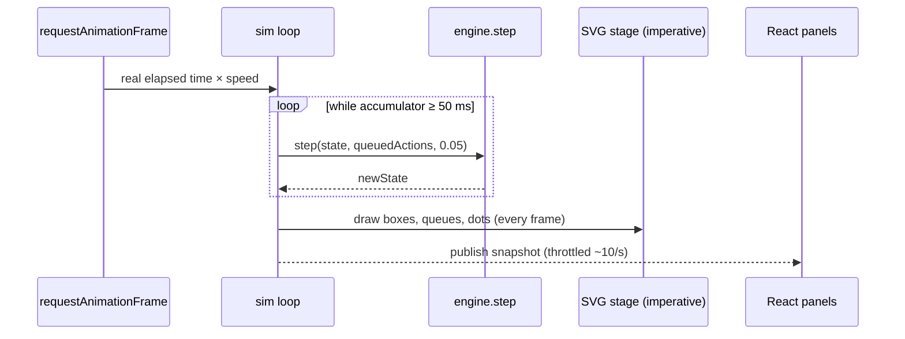

# Architecture

## Layers

```
            actions (setUsers, killNode, applyFix…)
 ┌────────┐ ─────────────────────────────▶ ┌─────────────┐  step(state, actions, dt)  ┌──────────────┐
 │  ui/   │                                │    sim/     │ ─────────────────────────▶ │   engine/    │
 │ React  │ ◀───── snapshot (~10/s) ────── │ loop + store│ ◀──────── newState ─────── │ pure TS math │
 └───┬────┘                                └──────┬──────┘                            └──────────────┘
     │ every frame (60/s), outside React          │
     └──────── dots + box colors ◀────────────────┘
 topics/  one page each, on shared kits
```

| Layer | Owns | Never does |
|---|---|---|
| `engine/` | Types, `step()`, metrics, seeded RNG | Imports React, reads the clock, draws |
| `sim/` | Fixed-timestep loop, pause/speed/reset, the store, action queue | Sim math |
| `ui/` | Components, SVG stage, dot sampler, charts | Sim math, mutating state |
| `kits/` | Shared visual kits and their models | Topic-specific content |
| `topics/<id>/` | One page: level/lab data, content, tests | Import another topic |

## One frame



- **Fixed step (50 ms of sim time).** Same seed + same actions = same run, at any speed.
  Slow-mo and 10× just change how many steps run per real second. (ADR 0005)
- **Two render speeds.** The stage redraws every frame without React. React panels
  (charts, "why" line, lesson) re-render ~10 times a second. (ADR 0005)

## Data model (sketch, M1 fields in bold)

```ts
type Tag = 'M' | 'R' | 'T';
interface Tagged<T> { value: T; tag: Tag; note: string; source?: string }  // source required for 'M'

type NodeKind = 'users' | 'server' | 'loadBalancer' | 'cache' | 'database';

interface SimNode {
  id: string; kind: NodeKind; label: string; awsTag?: string;  // awsTag: small label, e.g. "EC2"
  capacity: Tagged<number>;       // requests/s it can finish
  queueMax: number;               // waiting line length before it turns requests away
  baseLatencyMs: Tagged<number>;  // time per request when idle
  region: string; zone: string;   // always set; UI hides until a topic needs them
  up: boolean;                    // false = killed
}
interface SimEdge { id: string; from: string; to: string }

interface World {                 // what a level or sandbox starts from
  nodes: SimNode[]; edges: SimEdge[];
  traffic: { users: number; requestsPerUserPerSec: Tagged<number> };
  seed: number;
}

interface NodeStatus {            // computed each step
  incoming: number; served: number; dropped: number;   // requests/s
  queueLength: number; utilization: number; latencyMs: number;
  health: 'ok' | 'warn' | 'bad';
}
interface SimState {
  time: number; world: World; rng: RngState;
  nodes: Record<string, NodeStatus>;
  edges: Record<string, { rate: number }>;              // the UI samples dots from this
  totals: { latencyMs: number; errorRate: number; throughput: number };
}

type Action =
  | { type: 'setUsers'; users: number }
  | { type: 'killNode'; id: string }          // M2
  | { type: 'reviveNode'; id: string }        // M2
  | { type: 'replaceWorld'; world: World };   // apply a fix = swap topology
```

Why actions instead of setters: levels, tests, replays and (later) shareable links all become
"a world + a list of actions". (ADR 0005)

## Folder layout

```
src/
  engine/  types.ts  rng.ts  step.ts  metrics.ts  tagged.ts  *.test.ts
  sim/     loop.ts  store.ts  useSim.ts
  ui/      App.tsx  stage/  charts/  controls/  lesson/  theme.css
  kits/    flow/  (data-layout/ … when their first lab is built)
  topics/  index.ts  one-server/  (load-balancer/ …)
docs/      design + decisions
.github/workflows/  ci.yml  pages.yml
```
