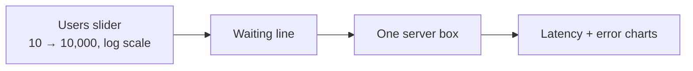

# M1: One box breaks

## Done when
- [ ] Moving the slider makes dots flow faster; past capacity they queue, box goes yellow → red
- [ ] Latency and error charts update live
- [ ] Pause, slow-mo and reset work
- [ ] "Why" line says what the box is doing (busy %, waiting, failing/s)
- [ ] `engine/` has unit tests; Playwright smoke test (load, raise users, server turns red); CI is green
- [ ] Deployed to GitHub Pages

Out of scope: load balancer, levels, Play mode, deep dives, kill buttons, React Flow.

## Steps (one PR each)

| # | PR | Contents | Proves |
|---|---|---|---|
| 1 | Scaffold | Vite + React + TS strict, Vitest, ESLint (engine import rule), Prettier, CI, Pages deploy + PR previews (Vite `base` from env), hash router, Playwright smoke test of a blank page | Pipeline works before any feature |
| 2 | Engine | `types`, `data/numbers/teaching.ts`, `rng`, `step` for users → one server, `metrics` (EMA), tests | The math, with no UI |
| 3 | Sim loop | fixed 50 ms step, accumulator, pause / speed / reset, store + `useSim` hook, tests with a fake clock | Determinism |
| 4 | Stage | `topics/one-server/` page + topic registry. SVG: users group, waiting line slots, server box with health color + busy bar, slider, "why" line | It's playable |
| 5 | Dots + charts | `DotLayer` (SVG) fed by a dot sampler from edge rate (red = dropped), uPlot latency + error, legend with M/R/T | It feels alive |

## Engine tests to write first (step 2)

| Given | Expect |
|---|---|
| utilization 0.5 for 10 s | queue 0, errors 0, health ok |
| utilization 0.85 | health warn, latency > 2× base |
| utilization 2.0 for 10 s | queue = queueMax, errorRate ≈ 0.5, health bad |
| load drops back to 0.5 | queue drains to 0 within a few seconds |
| same seed + same actions, run twice | identical states |
| 1,000 users, default numbers | breaks (errorRate > 0) — the lesson's promise |

## Risks
- **Dots lie.** They are sampled. Legend says "1 dot ≈ N requests".
- **Slider feel.** Log scale (10 → 10,000) or nothing interesting happens in the first half.
