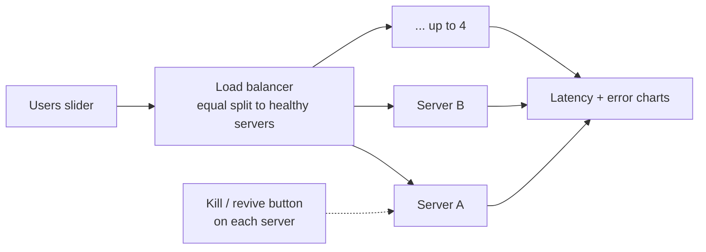

# M2: Load balancer + kill a server



The lesson, for both doors:

```
1 server breaks at ~1,000 users ──▶ add LB + 2nd server ──▶ holds ~1,600
        ──▶ kill one at 1,000 users ──▶ survivor at 125% ──▶ red   ← "2 servers is not redundancy"
        ──▶ 3 servers, kill one ──▶ survivor pair at ~62% ──▶ holds (N+1)
```

Learn sees "the other server has to carry everything". Design sees N+1 headroom and the error
spike while the LB is still sending traffic to a dead server.

## Done when
- [ ] Topic page `#/learn/load-balancer`: users → LB → 2 servers, server count 1–4
- [ ] Each server has a kill / revive button. Killed box is drawn as down (dashed outline + the word, per `design-system.md`), never color only
- [ ] After a kill, errors spike for the health-check window, then traffic moves to the survivors
- [ ] Dots split at the LB and follow each edge; red dots where requests are dropped
- [ ] "Why" line names the worst box ("Server B is down. Server A is 125% busy …")
- [ ] First **tradeoff card** (shared part) for "add a load balancer + second server"
- [ ] One-server page still works on the generalized stage (no behavior change)
- [ ] Engine tests below; Playwright smoke (load, kill a server, errors appear, survivor turns red); CI green
- [ ] Deployed to GitHub Pages

Out of scope (flagged, see bottom): kill AZ, LB algorithms (weighted, least connections),
LB capacity as a bottleneck, retries, autoscaling, Play mode wrapper (M3), Design mode (M4), p99.

## Steps (one PR each)

| # | PR | Contents | Proves |
|---|---|---|---|
| 0 | Plan (this) | M2 plan, ADR 0011 (LB model), ADR 0012 (stage layout), CLAUDE.md points at M2 | We agree before code |
| 1 | Engine: multi-hop | `step()` walks the graph in order (users first). A box's `served` becomes the next edges' rate. End-to-end latency follows the paths, weighted by traffic. Throws on cycles. **No new behavior**: M1 tests stay green unchanged | Refactor is safe |
| 2 | Engine: LB + kill | `loadBalancer` node kind (no capacity, small added latency), equal split across targets it *believes* are up, `killNode` / `reviveNode` actions, health-check delay, a killed box's waiting line counts as dropped. New numbers in `teaching.ts` | The failure math, with no UI |
| 3 | Flow kit: many boxes | `layoutColumns(world)` (pure, tested): column per hop, boxes spread in each column. Stage draws N boxes, each with its own waiting line. Dots per edge, split at the LB. `whyLine` picks the most urgent box. One-server page moves onto it | One stage for every Flow topic |
| 4 | Tradeoff card | `ui/shared/TradeoffCard` (Fixes / Cost / Complexity / New risk / Breaks next) + entry in `design-system.md` | Shared part lands alone |
| 5 | Load balancer page | `topics/load-balancer/`: world, server count stepper, kill / revive on each box, tradeoff card, registry line, Playwright smoke | It's playable |

Steps 3 and 4 don't depend on each other and can run in parallel after step 2.

```
0 ─▶ 1 ─▶ 2 ─┬─▶ 3 ─┬─▶ 5
             └─▶ 4 ─┘
```

## Engine tests to write first (steps 1–2)

| Given | Expect |
|---|---|
| M1 one-server world, all M1 cases | identical results to M1 (regression) |
| users → LB → 2 servers, 1,000 users | each server gets 50 req/s, both ok, errors 0 |
| same, kill server B | for the health-check window: B's share dropped (errorRate ≈ 0.5) |
| after the window | all traffic on A (100 req/s), A bad, errors > 0 |
| 3 servers, 1,000 users, kill one | after the window: survivors ~62% busy, errors 0 |
| B had a waiting line when killed | that line counts as dropped once, then B shows 0 |
| revive B | after the window, split goes back to equal |
| all servers down | errorRate = 1, no division by zero |
| end-to-end latency | = LB latency + traffic-weighted server latency |
| world with a cycle | `createState` throws |
| same seed + same actions, run twice | identical states |

## New numbers (`teaching.ts`, ADR 0009)

| Id | Value | Tag | Note |
|---|---|---|---|
| `lb.baseLatencyMs` | 2 ms | T | The LB adds a little time to every request |
| `lb.healthCheckSeconds` | 3 s | T | Time before the LB notices a box died (or came back). Real defaults are tens of seconds (e.g. AWS ALB: 30 s checks × 2 failures); 3 s keeps the lesson watchable |

Design (M4) gets the real range in `typical.ts` with its source.

## Decisions this plan needs (ADRs, status proposed)
- **[0011](../decisions/0011-load-balancer-in-flow-math.md)**: LB is a router, not a worker: no
  capacity, equal split, health-check delay.
- **[0012](../decisions/0012-stage-layout-from-the-graph.md)**: the stage lays itself out from
  the world graph (columns), instead of a hand layout per topic.

## Scope creep: what we're **not** doing, and when it comes
| Idea | Why not now | When |
|---|---|---|
| Kill AZ | needs zones drawn on the stage; engine already has `zone` | LB level in Play (after M3) or Design M4 |
| Weighted / least-connections | the equal split is the lesson; other splits are a comparison | Lab 19 "LB algorithms" |
| LB as a bottleneck | real managed LBs rarely are at this scale; would muddy the lesson | Design, if engineers ask |
| Client retries / retry storms | great lesson, but a new engine feature | own topic later |
| Autoscaling | capacity over time | Topic 4 |

## Risks
- **Graph walk changes M1 math.** Step 1 is a pure refactor with M1 tests unchanged; any diff is a bug.
- **Stage gets busy at 4 servers.** Cap at 4; dots per edge share one budget (`MAX_DOTS`).
- **Health-check delay confuses beginners.** The "why" line says it out loud: "The load
  balancer hasn't noticed yet. It still sends 1 in 2 requests to Server B."
