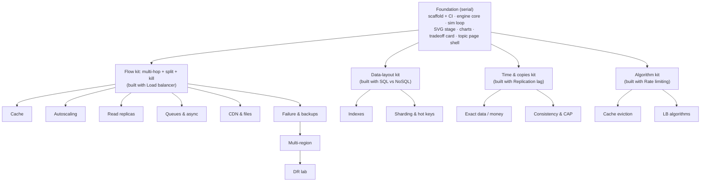

# Roadmap: topics as independent pages

Each topic is **one page** in its own folder. Topics never import each other, so several can be
built at the same time. They are **not** fully independent though: they share the engine and a
visual kit. That shared part is built first, then the work fans out.

## What must exist before going parallel



```
Serial:    Foundation ──▶ first topic of each kit (builds the kit)
Parallel:  4 kit lanes run side by side; inside a lane, most topics run side by side too
```

## Topic list

Page types: **Level** = Play mode (predict → break → fix), **Lab** = A vs B comparison,
**Deep dive** = reading page for one part.

| # | Topic | Page | Kit | Engine/kit feature it adds | Can start after |
|---|---|---|---|---|---|
| 1 | One server | Level | Flow | single box (M1) | Foundation |
| 2 | Load balancer (+ kill server, kill AZ) | Level | Flow | multi-hop, split, `up` flag | 1 |
| 3 | Cache | Level | Flow | hit-rate split | 2 |
| 4 | Autoscaling | Level | Flow | capacity over time, boot lag | 2 |
| 5 | Read replicas | Level | Flow | read/write split | 2 |
| 6 | Queues & async jobs | Level | Flow | async node (user doesn't wait) | 2 |
| 7 | CDN & files | Level | Flow | edge cache by region | 2 |
| 8 | Failure & backups | Level | Flow | kill + restore with data loss | 2 |
| 9 | Multi-region (+ global users, kill region) | Level | Flow | user groups, distance latency | 8 |
| 10 | DR ladder (RTO/RPO) | Lab | Flow | recovery timeline | 9 |
| 11 | SQL vs NoSQL | Lab | Data layout | builds the kit | Foundation |
| 12 | Indexes | Lab | Data layout | rows-scanned counter | 11 |
| 13 | Sharding & hot keys | Lab | Data layout | keys → shards | 11 |
| 14 | Replication lag | Lab | Time & copies | builds the kit | Foundation |
| 15 | Exact data (money, idempotency) | Lab | Time & copies | retries + duplicate detection | 14 |
| 16 | Consistency & CAP | Lab | Time & copies | partitions | 14 |
| 17 | Rate limiting | Lab | Algorithm | builds the kit | Foundation |
| 18 | Cache eviction (LRU vs LFU) | Lab | Algorithm | eviction policies | 17 |
| 19 | LB algorithms | Lab | Algorithm (+ Flow) | per-server speed | 2, 17 |
| 20 | Outside services, Cost | Deep dive | none | none | anytime |

v1 scope stays: topics 1–3 + 11 + one deep dive per part. The rest is the queue, not a promise.

## How parallel work stays safe

```
src/topics/<topic-id>/   page.tsx · level.ts or lab.ts · content.md · *.test.ts
        │ may import
        ▼
src/kits/<kit>/   src/engine/   src/ui/shared/        ✗ never another topic
```

1. **Shared code lands first, alone.** A topic that needs a new engine or kit feature ships that
   feature as its own small PR (with tests). Then the topic page is built on top. This keeps two
   parallel topics from editing the same engine file at the same time.
2. **One registry line per topic.** `src/topics/index.ts` lists topics. It's the only shared
   file a topic PR touches.
3. **Lint rule:** no imports between topic folders.
4. **One topic = one branch = one thread/session.**

See [ADR 0007](decisions/0007-topics-as-isolated-pages.md) for why.
